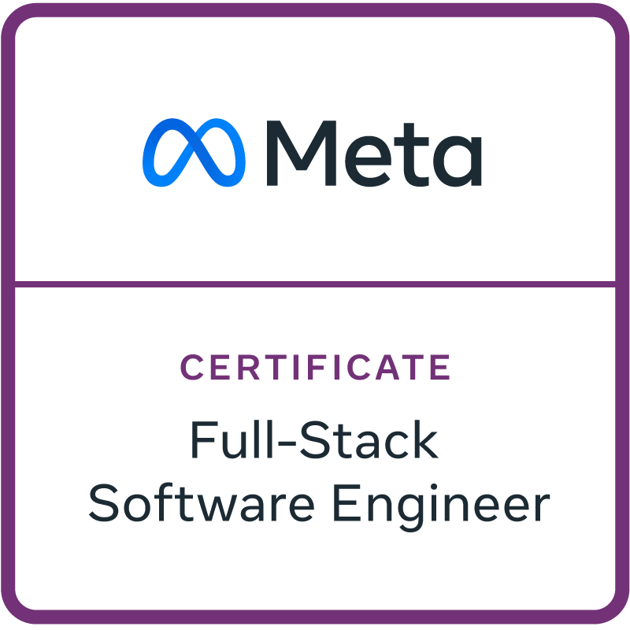
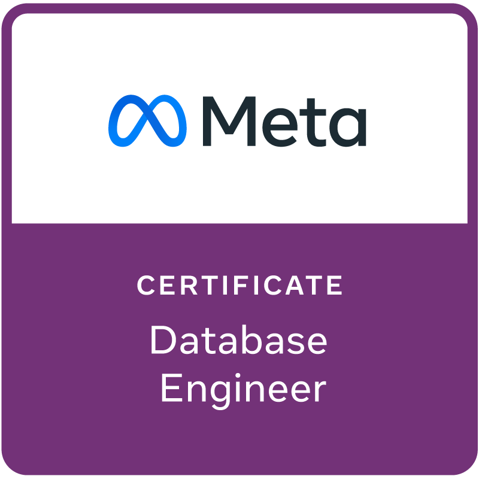
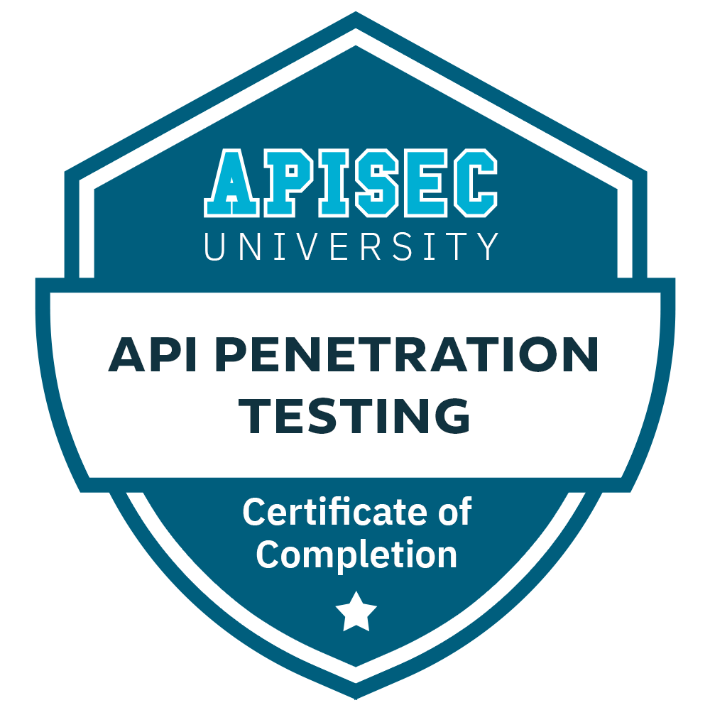
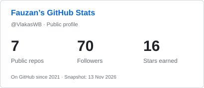
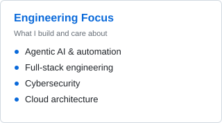

<!-- Profile README for VlakasWB/VlakasWB. Statistics are a dated public-data snapshot. -->

<h3>Cuy, I’m Fauzan Abdurrahman.</h3>

I’m a <strong>Principal Software Engineer</strong>, focused on <strong>Agentic AI</strong> and <strong>cybersecurity</strong>.

Building practical, high-performance software for startups and enterprises.

  
  &nbsp;
  
  &nbsp;
  

Meta Full-Stack Engineer · Meta Database Engineer · API Penetration Testing

<h2>💫 About Me</h2>

I build software where <strong>full-stack engineering, Agentic AI, and security</strong> come together.

<ul>
  <li><strong>7+ years</strong> of professional experience, exploring technology since <strong>2014</strong>.</li>
  <li>Focused on Agentic AI, scalable systems, and secure software delivery.</li>
  <li>I enjoy solving complex problems and collaborating across disciplines.</li>
  <li>Outside of coding: photography, traveling, anime, and gaming.</li>
</ul>

<h2>🌐 Socials</h2>

  
  
  
  

<h2>💻 Tech Stack</h2>

Agentic AI · LLM applications · Workflow automation

<strong>Programming languages</strong>

  
  
  
  
  
  
  
  

<strong>Frameworks, libraries & runtime</strong>

  
  
  
  
  
  
  
  
  

<strong>Databases</strong>

  
  
  
  
  
  
  
  

<strong>AI & computer vision</strong>

  
  

<strong>Cloud & infrastructure</strong>

  
  
  
  
  

<strong>Security tools</strong>

  
  

<h2>📊 GitHub Stats</h2>

  <a href="https://github.com/VlakasWB?tab=repositories"><picture>
    <source media="(prefers-color-scheme: dark)" srcset="assets/github-stats-dark.svg" />
    
  </picture></a>
  <a href="https://www.fazman.me/"><picture>
    <source media="(prefers-color-scheme: dark)" srcset="assets/engineering-focus-dark.svg" />
    
  </picture></a>

Public data snapshot · 13 November 2026 · Excludes private repository activity. Engineering Focus is a curated profile summary.

Open to thoughtful conversations about software, AI, and security. 
<a href="https://www.fazman.me/">Explore my work at <strong>fazman.me</strong></a>

